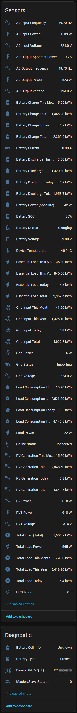
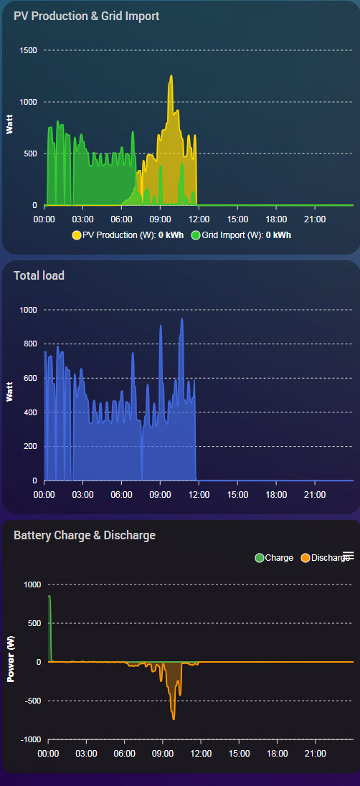
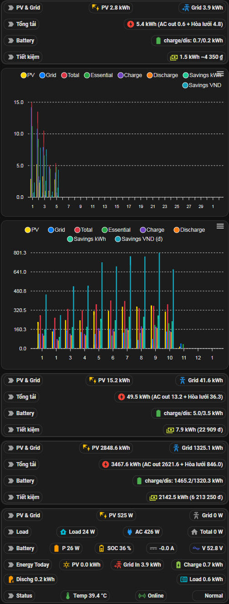

# Lumentree Inverter for Home Assistant

<!-- readme-axi type=ha -->

[](https://github.com/hacs/integration)
[](https://github.com/ngoviet/lumentreeHA/releases)
[](https://github.com/ngoviet/lumentreeHA/stargazers)
[](https://buymeacoffee.com/ngoviet)
[](https://github.com/sponsors/ngoviet)

**English** · [Tiếng Việt](README.vi.md)

Monitor a **Lumentree hybrid solar inverter** (SUNT series) in Home Assistant: live power, battery and grid readings every 5 seconds, plus daily, monthly, yearly and lifetime energy statistics with charts and electricity-cost savings in VND.

<a href="https://my.home-assistant.io/redirect/hacs_repository/?owner=ngoviet&repository=lumentreeHA&category=integration" target="_blank"></a>

> 🇻🇳 Built and maintained by one person in Việt Nam — if it saves you time, please
> [support the project](#support-the-project).

| Sensors | 24 h energy charts | Statistics summary |
|---|---|---|
|  |  |  |

## Contents

- [Features](#features)
- [Requirements](#requirements)
- [Installation](#installation)
- [Configuration](#configuration)
- [Entities](#entities)
- [Services](#services)
- [Troubleshooting](#troubleshooting)
- [How it works](#how-it-works)
- [Development](#development)

## Features

- **Live readings every 5 s** over MQTT: PV (two strings), battery power, voltage, current and SOC, grid, load, AC input and output, temperature, and battery cells.
- **Inverter settings** read from the device: charge voltages and currents, protection thresholds, work mode, AI mode, grid type and more. These are diagnostic sensors and are read-only.
- **Energy statistics** for today, this month, this year and lifetime:
  - PV generation
  - battery charge and discharge
  - grid import
  - household load, essential load and total load
- **Savings**: energy you didn't buy from the grid (kWh) and its value in VND, at a fixed tariff of 2,900 VND/kWh.
- **Chart-ready attributes**:
  - 5-minute and hourly series for today
  - a value per day for the month
  - a value per month for the year
- **History backfill**: on first start the integration fills up to 5 years of past data and keeps it on disk.
- **Several inverters**: add one config entry per inverter.
- **Read-only**: the integration never changes inverter settings and never calls a vendor write endpoint.

## Requirements

| | |
|---|---|
| Home Assistant | **2024.4** or newer (HACS blocks older versions) |
| Network | Outbound internet to `lesvr.suntcn.com`: port **1886** (MQTT) and **80** (HTTP) |
| Inverter | Online in the Lumentree / LightEarth app, with its **Device ID** (e.g. `H240909079`) |

Python dependencies (`paho-mqtt`, `crcmod`) are installed by Home Assistant automatically.

## Installation

### HACS (recommended)

1. Click the **Open in HACS** button above, or in HACS open **⋮ → Custom repositories**, add `https://github.com/ngoviet/lumentreeHA` with type **Integration**.
2. Download **Lumentree Inverter**.
3. Restart Home Assistant.

### Manual

1. Download the latest [release](https://github.com/ngoviet/lumentreeHA/releases).
2. Copy the repository contents into `<config>/custom_components/lumentree/`, so that `manifest.json` ends up at `custom_components/lumentree/manifest.json`.
3. Restart Home Assistant.

### Updating

When a new release is published, HACS shows it under **Settings → Updates** and in HACS itself. Install it, then **restart Home Assistant**.

If you want to see the update straight away, open the repository in HACS and choose **⋮ → Update information**.

Release notes, including anything you'll notice after updating, are on the [Releases page](https://github.com/ngoviet/lumentreeHA/releases).

## Configuration

1. Go to **Settings → Devices & Services → Add Integration** and search for **Lumentree Inverter**.
2. Enter the **Device ID**. It's printed on the inverter label and shown in the Lumentree app.
3. Confirm the device that is found.

Repeat for each inverter. To change the Device ID later, choose **Reconfigure** on the integration entry.

During the first few minutes after setup the integration downloads your history (see [Statistics and history](#statistics-and-history)). Monthly, yearly and lifetime values fill in as that finishes.

## Entities

Entity IDs follow the pattern `sensor.device_<serial>_<key>`, for example `sensor.device_h240909079_battery_soc`.

### Real-time (MQTT): 55 sensors

| Group | Sensors |
|---|---|
| Power | PV, PV1\*, PV2\*, Battery, Grid, Load, Total Load, AC Output, AC Output Apparent Power, AC Input, Generator |
| Voltage | Battery, PV1\*, PV2\*, Grid, AC Output, AC Input\* |
| Current | Battery, AC Input, AC Output |
| Frequency | AC Output, AC Input |
| Battery | SOC, Status, Type, Battery Cell Info (cell voltages as attributes) |
| Status | Grid Status, Master/Slave, Self-Consumption Ratio, Device Temperature, PV Input Today |
| Settings (diagnostic) | Battery Capacity, Max Charge Current, Max Discharge Current, Equalizing / Boost / Float Charge Voltage, Low Voltage Protection, Recovery Voltage, Low Capacity Cutoff, Protecting Recovery Point, Equalizing Charge Interval and Time, CT Trickle Feed, AI Mode, Grid Type, AC Output Frequency Setting, Charge From AC, AC Coupling, Work Mode, Battery Mode |
| Info (diagnostic) | Firmware Version, Controller Version, Device SN (MQTT)\*, Last Raw MQTT Hex\* |

\* Disabled by default (7 sensors). Enable them under the device's entity list if you need them.

Some inverters send a shorter MQTT frame, and the settings in its upper range then stay `unknown`. That's expected; see [register availability by frame length](docs/api/REGISTER_MAP.md#frame-layout).

### Statistics (HTTP): 28 sensors

| Period | Sensors | Chart attributes |
|---|---|---|
| Today (7) | PV, Charge, Discharge, Grid Input, Load, Essential Load, Total Load | `series_5min_w`, `series_5min_kwh`, `series_hour_kwh`, `saved_kwh`, `savings_vnd` |
| This Month (7) | same | `daily_pv`, `daily_charge`, …, `daily_saved_kwh`, `daily_savings_vnd` (one value per day) |
| This Year (7) | same | `monthly_pv`, `monthly_charge`, …, `monthly_saved_kwh`, `monthly_savings_vnd` (one value per month) |
| Total (7) | same, lifetime | `years_processed`, `earliest_year`, `latest_year` |

All statistics refresh every 5 minutes, and **today is included** in the month, year and lifetime figures. The "Today" sensors work in the Home Assistant **Energy dashboard**.

### Binary sensors: 2

- **Online Status**: goes off when no MQTT frame has arrived for 12.5 s.
- **UPS Mode**

### Statistics and history

- **Today** comes live from the Lumentree cloud every 5 minutes.
- **Finished days** are stored on disk in `<config>/.storage/lumentree_stats/<device>/<year>.json`. The month, year and lifetime figures are computed from them, plus today's live values.
- **On every start** the integration fills in missing history a month at a time, up to 5 years back. A restart with complete history only asks the cloud for the current month.
- **Shortly after midnight** (00:20) it saves yesterday's final totals and fills any gaps.
- A day is only stored once it is over, so a value read in the middle of the day is never kept.

Nothing needs to be configured. If the history looks wrong, see [Services](#services) to rebuild it.

### Dashboards

Ready-made Lovelace dashboards are in [`docs/dashboard/`](docs/dashboard/):

- [Daily statistics](docs/dashboard/dashboard_daily_stats.yaml)
- [PV and grid](docs/dashboard/dashboard_pv_grid.yaml)
- [Total load](docs/dashboard/dashboard_total_load.yaml)
- [Battery charge and discharge](docs/dashboard/dashboard_battery_charge_discharge.yaml)

Setup notes are in [DASHBOARD_README.md](docs/dashboard/DASHBOARD_README.md), and fixes for common chart problems in [TROUBLESHOOTING_GUIDE.md](docs/dashboard/TROUBLESHOOTING_GUIDE.md).

## Services

All services are under the `lumentree` domain. Each accepts an optional **`device_sn`**: without it, the service runs for every configured inverter.

| Service | What it does |
|---|---|
| `smart_backfill` | Fill missing history month by month (fast). Options: `max_years`, `optimize_cache`. |
| `purge_and_backfill` | Delete the stored history and rebuild it with `smart_backfill`. |
| `backfill_all` | Rebuild history day by day (slow, one request per day). Use this if `smart_backfill` reports that the cloud ignores the month. |
| `backfill_gaps` | Fill missing days, a limited number per run. |
| `backfill_now` | Fill the last N finished days. |
| `backfill_empty_dates` | Re-check days that were recorded as empty. |
| `recompute_month_year` | Recompute this year's month and year sums from the stored days. |
| `optimize_cache` | Remove empty days from the stored files. |
| `purge_cache` / `purge_all_cache` | Delete one year's history, or all of it. |
| `mark_empty_dates` / `mark_coverage_range` | Manual corrections to the stored history. |
| `enable_purge_on_startup` / `disable_purge_on_startup` | Purge and rebuild history on the next restart (switches itself off afterwards). |

Example (rebuild history for one inverter):

```yaml
service: lumentree.purge_and_backfill
data:
  device_sn: H240909079
  max_years: 5
```

## Troubleshooting

**Setup fails or keeps retrying.** Check that Home Assistant can reach `lesvr.suntcn.com` on ports 80 and 1886. If the cloud or broker is down, Home Assistant retries the setup automatically.

**Live sensors stop updating.** Check **Online Status**. The integration reconnects to MQTT on its own with increasing delays. If the inverter itself is offline in the Lumentree app, nothing will arrive.

**Statistics show `unavailable`.** The Lumentree cloud didn't answer the last request. The sensors recover on the next successful refresh, within 5 minutes.

**Month / year / lifetime values look too low.** History may still be downloading after the first start. Wait a few minutes, or run `lumentree.smart_backfill`.

**Debug logging:**

```yaml
logger:
  logs:
    custom_components.lumentree: debug
```

When reporting a bug, attach **Download diagnostics** from the device page (the token is redacted) and the debug log. Use the [issue tracker](https://github.com/ngoviet/lumentreeHA/issues).

## How it works

```
Inverter ──► Lumentree cloud ──┬── MQTT  reportApp/<serial>  ──► live sensors (5 s)
                               │   (Modbus-RTU frames; the integration
                               │    publishes read requests to listenApp/<serial>)
                               └── HTTP  lesvr.suntcn.com     ──► statistics (5 min)
                                                                  + history on disk
```

Protocol and register details for contributors are in [`docs/`](docs/README.md):

- [API protocol](docs/api/API_PROTOCOL.md)
- [Register map](docs/api/REGISTER_MAP.md)
- [Cache and backfill](docs/api/CACHE_AND_BACKFILL.md)
- [Development notes](docs/DEVELOPMENT_NOTES.md)

## Development

To contribute, see [CONTRIBUTING.md](CONTRIBUTING.md). Tests run with `pytest tests/`, linting with `ruff check .`.

<!-- support:start -->
## Support the project

<p align="center">
  
</p>

<p align="center">
  <a href="https://buymeacoffee.com/ngoviet"></a>
  &nbsp;
  <a href="https://github.com/sponsors/ngoviet"></a>
</p>

<p align="center">
  
  &nbsp;
  
</p>

<p align="center"><b>Crypto wallet, BNB Smart Chain (BEP20) only:</b><br><code>0xcbf0402b232cb24b4d998f09a4884f87b5f74750</code></p>

<p align="center"><sub>🇻🇳 VietQR: scan with any Vietnamese banking app, transfer note <code>Ung ho lumentreeHA</code>. Thank you for keeping this project alive!</sub></p>
<!-- support:end -->

## License

[MIT](LICENSE) © Ngô Đức Việt. Not affiliated with Lumentree or SUNTCN.
